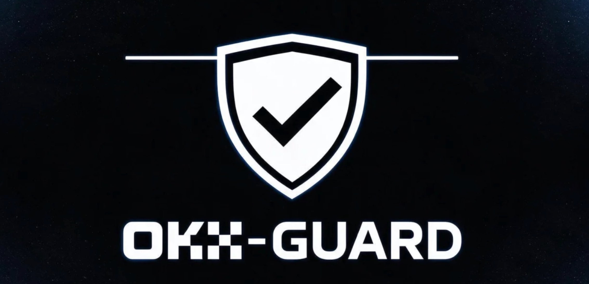

<p align="center"></p>

<p align="center">
  <a href="https://github.com/a1exyiran/okx-guard/actions/workflows/test.yml"></a>
  
  
  
</p>

<p align="center">
本地运行的开源 OKX 现货工具：<b>先看清手续费，再带着护栏下单。</b><br>
A local, open-source OKX spot tool: <b>see what your trading costs, then trade with hard guardrails.</b>
</p>

> ⚠️ **非 OKX 官方项目。** okx-guard 是独立开发者的开源工具，与 OKX 没有隶属或背书关系。"OKX" 是其所有者的商标。
> 本工具不提供投资建议，不承诺任何收益。加密资产交易可能损失全部本金。

---

## 为什么做这个

我们自己做量化实验时发现，很多"回测赚钱"的策略到了真实环境，利润大多被**手续费和过度交易**吃掉了：
秒级追涨、每小时调仓、10 倍杠杆，扣完成本几乎全是负数。okx-guard 只做两件事：

1. **体检报告（只读）**：告诉你过去 90 天交了多少手续费，按现在的频率一年会吃掉多少权益。
2. **带护栏下单**：给手动交易、脚本或 AI 助手加一道硬性限额，防止一时冲动或程序出错把账户打穿。

## 功能

### 1. 交易体检报告 `report`

只需要**只读**权限的 API Key。统计近 N 天的现货成交（USDT/USDC 计价）：

| 指标 | 说明 |
|---|---|
| 成交笔数 / 订单数 / 有交易的天数 | 交易频率 |
| 成交额、手续费合计、手续费/成交额 | 真实成本 |
| 吃单（taker）比例 | 吃单费率通常高于挂单 |
| 一年手续费占当前权益 | 按当前频率外推 |
| 红 / 黄 / 绿灯 | 红：年化手续费超过权益 10% 或每天超过 10 单；黄：超过 3%、每天超过 3 单或吃单超过 80% |

示例输出见 [docs/sample_report.md](docs/sample_report.md)（虚构数据）。

### 2. 带护栏的下单 `buy` / `sell`

| 护栏 | 默认值 |
|---|---|
| 品种白名单 | BTC-USDT、ETH-USDT |
| 单笔上限 | 20 USDT |
| 每日笔数上限 | 3 笔 |
| 每日买入总额上限 | 50 USDT |
| 同品种冷却 | 60 分钟 |
| 一键暂停 | `halt` / `resume` |
| 只做现货 cash 模式 | 拒绝杠杆和合约账户模式，不借币 |
| 卖出必须写明数量 | 不会"按全部余额卖出" |
| 防重复下单 | 同一意图生成固定 `clOrdId`，重跑会先查询；网络超时、结果未知时拒绝重下 |
| 审计日志 | `~/.okx-guard/audit.jsonl`，每次尝试记一行，不记录任何密钥 |
| 下单后回查 | 查询成交状态、均价、手续费 |
| 默认模拟盘 | 实盘需要 `OKX_PROFILE=live` **并且**加 `--confirm-live` |

所有限额都可以在 JSON 配置里改，见 [`guard_config.example.json`](guard_config.example.json) 和 [docs/CONFIG.md](docs/CONFIG.md)。

## 安装

需要 Python 3.10 或更高版本。

```bash
git clone https://github.com/a1exyiran/okx-guard.git
cd okx-guard
python3 -m venv .venv && source .venv/bin/activate
pip install -r requirements.txt
python -m unittest -v test_guard.py        # 离线测试，不联网、不需要 Key
```

## 快速开始

**1. 创建 API Key。** 先用模拟盘 Key（[创建页面](https://www.okx.com/account/my-api?go-demo-trading=1)）。
权限只勾 **读取**（只看报告）或 **读取 + 交易**（要下单）。**永远不要勾提现。**

**2. 把 Key 存进只有你能读的本地文件**，不要写进代码，也不要发给任何人：

```bash
mkdir -p ~/.okx-guard && cat > ~/.okx-guard/demo.env <<'EOF'
OKX_PROFILE=demo
OKX_API_KEY=...
OKX_SECRET_KEY=...
OKX_PASSPHRASE=...
EOF
chmod 600 ~/.okx-guard/demo.env
set -a; source ~/.okx-guard/demo.env; set +a
```

**3. 运行：**

```bash
python cli.py report --days 90                                              # 体检报告（只读）
python cli.py --config guard_config.example.json buy BTC-USDT --quote 5     # 市价花 5 USDT 买入
python cli.py --config guard_config.example.json sell BTC-USDT --size 0.00005
python cli.py buy BTC-USDT --size 0.0001 --px 60000                         # 限价单
python cli.py halt      # 暂停所有下单
python cli.py resume    # 恢复
python cli.py log       # 最近 20 条审计记录
```

退出码：`0` 成功，`2` 被护栏或配置拒绝，`3` 已下单但未能确认归因（请核对后再继续）。

## 工作原理

```
你的命令 ─▶ 前置检查（账户模式 / 品种规则 / 最新价）
          ─▶ 计算数量（按 lotSz 向下取整，检查最小下单额）
          ─▶ 按 clOrdId 查询：已存在则跳过（防重复）
          ─▶ 护栏检查（HALT / 白名单 / 单笔 / 每日 / 冷却）── 不通过 ─▶ 记日志并拒绝
          ─▶ 下单（签名后直接发往 OKX）
          ─▶ 回查成交与归因 ─▶ 写审计日志
```

详见 [docs/ARCHITECTURE.md](docs/ARCHITECTURE.md)。

## 透明说明：开发者如何获得收入

okx-guard 参加了 OKX [AI Builder Program](https://www.okx.com/agent-tradekit/builder)。
通过本工具下的每笔订单，都会在 OKX 订单字段 `tag` 里带上开发者的 AI Builder Code，
OKX 会把这笔成交手续费的一部分返给开发者。

- 本工具**不额外收费**，也不会修改你的费率。
- 代码完全公开：归因只出现在 `guard.py` 的 `BUILDER_CODE` 和下单请求的 `tag` 字段，你可以自行审查。
- 体检报告是只读的，不产生交易，开发者从中没有收入。
- 开发者收入随你的交易量增加，所以我们**故意**把默认限额设得很保守。如果你觉得本工具在鼓励你多交易，请提 issue。

详见 [docs/BUILDER_ATTRIBUTION.md](docs/BUILDER_ATTRIBUTION.md)。

## 安全

- API Key 只存在你自己的电脑上，本工具不会上传到任何服务器，所有请求直接发往 OKX。
- OKX 签名代码 `okx_openapi_client.py` 原样取自 OKX 官方示例
  [okx/builder-integration-demo](https://github.com/okx/builder-integration-demo)（MIT，见 `LICENSE.okx-demo`），未做修改。
- 发现安全问题请看 [SECURITY.md](SECURITY.md)。

## 项目状态与路线图

当前版本 **v0.1.0（beta）**，更新记录见 [CHANGELOG.md](CHANGELOG.md)。

- [x] 只读体检报告
- [x] 现货护栏下单、幂等、审计日志
- [x] 离线测试与 CI
- [ ] 模拟盘端到端验证与归因确认
- [ ] 体检报告增加盈亏和"手续费吃掉的收益"
- [ ] 供 AI 助手调用的接口（MCP）
- [ ] 每日额度改为从 OKX 成交记录核对，而不只依赖本地日志

## 已知限制

- 只支持现货、OKX 账户模式 1/2；只统计 USDT/USDC 计价的成交。
- 体检报告不计算盈亏，只看手续费和交易频率。
- 每日限额以本地审计日志为准，换电脑或删日志会重置。
- 按 OKX 全球站设计；其他站点需设置 `OKX_API_BASE_URL`，并自行核对接口。

## 参与贡献

欢迎提 issue 和 PR，请先读 [CONTRIBUTING.md](CONTRIBUTING.md)。

---

## English

okx-guard is an unofficial, open-source tool that runs on your own machine with your own OKX API key.

- **`report`**: a read-only trading health check covering fees, turnover, taker ratio, trading frequency, and projected yearly fees as a share of equity, graded red/yellow/green.
- **`buy` / `sell`**: spot-only orders with hard guardrails. These include a whitelist, per-order and daily limits, a per-instrument cooldown, a kill switch, no leverage, an explicit sell size, idempotent client order IDs, and an append-only audit log that contains no secrets.
- Demo trading is the default. Live trading requires `OKX_PROFILE=live` **and** `--confirm-live`. Never enable withdrawal permission on the key.
- **Disclosure:** orders carry the developer's OKX AI Builder Code in the `tag` field, and OKX shares part of the trading fee with the developer. The tool charges nothing extra.

Not financial advice. Not affiliated with OKX.

## License

MIT, see [LICENSE](LICENSE). `okx_openapi_client.py` is © OKX, also MIT; see [LICENSE.okx-demo](LICENSE.okx-demo).
